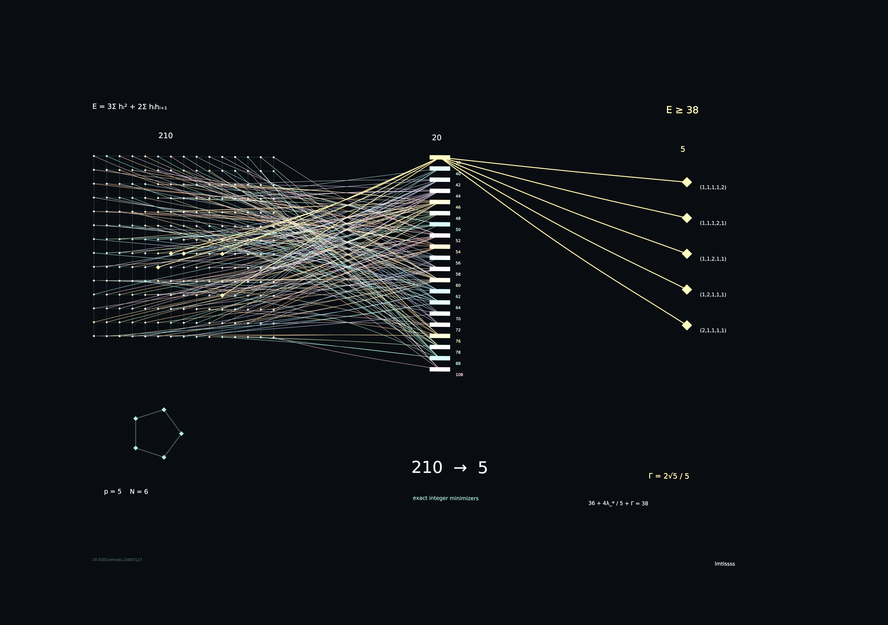
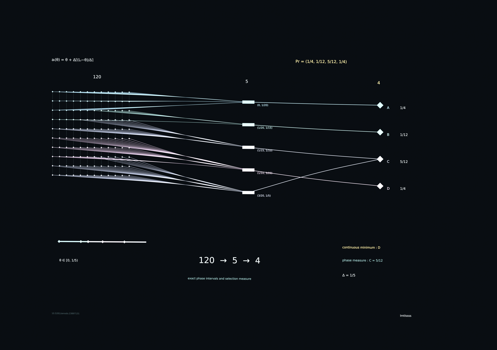
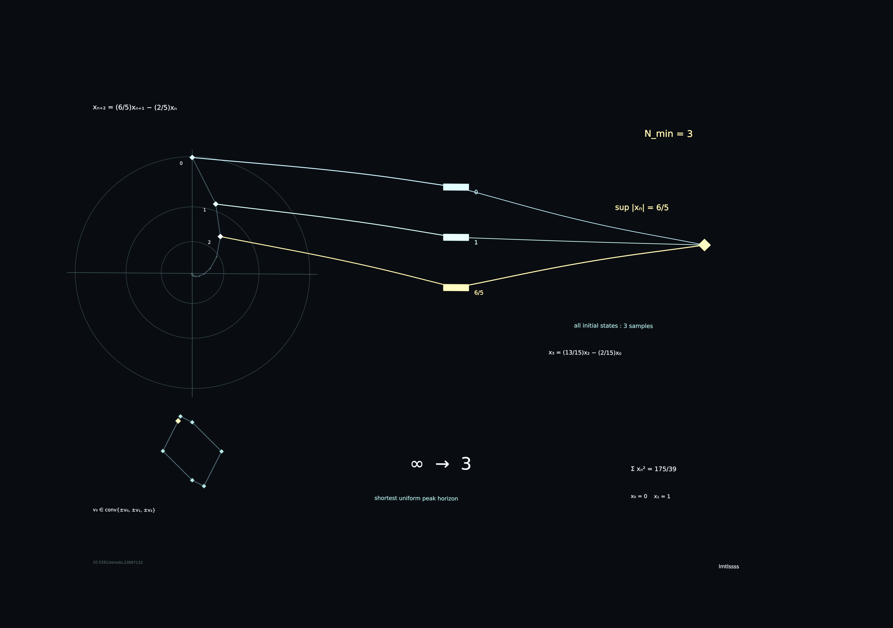

# Analysis

Exact finite representations, arithmetic spectral gaps, lattice-phase selection and minimal recurrence horizons.

## Full-resolution figure gallery

All three images below are the original **3840 × 2705 PNGs**. Open the image file to select **Download raw file** in GitHub.

### Cyclic-Shift Energies: Minimal State and Cyclotomic Gaps

[Download original 4K PNG](cyclic-shift-energies/figures/00-cover-4k.png) · [DOI](https://doi.org/10.5281/zenodo.23897127)

### Robust Amplitude Elimination and Exact Lattice-Phase Selection

[Download original 4K PNG](homogeneous-amplitude-elimination/figures/00-cover-4k.png) · [DOI](https://doi.org/10.5281/zenodo.23897131)

### Sharp Observation Bounds and Minimal Peak Horizons for Damped Recurrences

[Download original 4K PNG](damped-recurrence-certificates/figures/00-cover-4k.png) · [DOI](https://doi.org/10.5281/zenodo.23900237)

### Cyclic-Shift Energies: Minimal State and Cyclotomic Gaps

[Paper and exact source](cyclic-shift-energies/README.md) · [DOI](https://doi.org/10.5281/zenodo.23897127) · [Release](https://github.com/lmtlssss/math/releases/tag/cyclic-shift-energies-v1.0.0)

A cyclotomic divisibility criterion decides equality in an integer-occupancy spectral bound. At prime periods, algebraic norms yield a quantitative positive gap for nonflat spectra. The bound is attained at exactly five occupancies in a complete 210-state example. Minimal linear state and retained-potential identities supply the representation framework.

### Robust Amplitude Elimination and Exact Lattice-Phase Selection

[Paper and exact source](homogeneous-amplitude-elimination/README.md) · [DOI](https://doi.org/10.5281/zenodo.23897131) · [Release](https://github.com/lmtlssss/math/releases/tag/homogeneous-amplitude-elimination-v1.0.0)

A complete exact selection law for a translating common lattice reduces finite robust designs to residue cells and affine envelopes. It gives rational selection probabilities, expected optima and boundary decisions. A four-design example separates the continuous winner from the phase-selection probabilities. A second theorem proves persistent reversal under arbitrarily fine lattice refinement.

### Sharp Observation Bounds and Minimal Peak Horizons for Damped Recurrences

[Paper and exact source](damped-recurrence-certificates/README.md) · [DOI](https://doi.org/10.5281/zenodo.23900237) · [Release](https://github.com/lmtlssss/math/releases/tag/damped-recurrence-certificates-v1.0.1)

Exact coefficient inequalities classify the stable conjugate-root recurrences with minimal uniform peak horizon two or three. A symmetric observation hexagon supplies necessity and sufficiency. An explicit rational boundary example has shortest uniform horizon three. Sharp observation constants, rational adaptive certificates and exact Stein sums accompany the new coefficient-region result.
