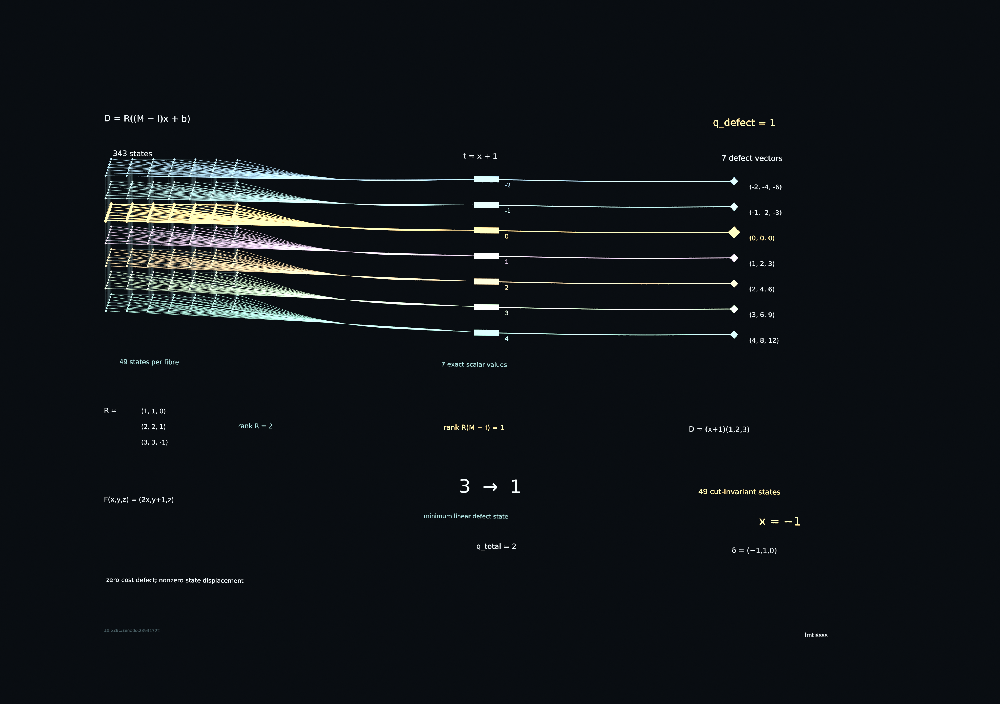

# Affine Cycles: Exact Cut Defects and Minimal Retained State

**lmtlssss🜐 · 3 November 2026 · version 1.0.0**

DOI: [10.5281/zenodo.23931722](https://doi.org/10.5281/zenodo.23931722)

## Result

Let an ordered word carry affine state maps and affine local costs. Evaluate each cost before its state transition. Compare every cyclic rotation at the state reached by the original word at that cut. If the full state map is `F(x)=Mx+b` and the rows of `R` are the accumulated prefix-cost coefficients, the complete defect vector is

`D(x)=R((M-I)x+b)`.

The exact minimum number of retained linear coordinates is `rank(R(M-I))`. For all transported cut totals, it is the rank obtained by adjoining the full-cost row to `R(M-I)`. The decoder may be arbitrary; the summary is linear and recovery holds for every real initial state. The affine system `R(M-I)x=-Rb` gives every cut-invariant state.

The principal rational example has three state coordinates, one required defect coordinate, two required total-cost coordinates, and a whole plane of cut-invariant states. Its cycle has no fixed point. The polynomial extension gives a finite derivative-coefficient rank for the same linear-summary contract.

## Full-resolution mathematical figure

[Download original 3840 × 2705 PNG](figures/00-cover-4k.png) · [Zenodo archival PNG](https://zenodo.org/api/records/23931722/files/cover_4k.png/content) · [GitHub release assets](https://github.com/lmtlssss/math/releases/tag/affine-cycles-v1.0.0)

## Files

| File | Content |
| --- | --- |
| `paper.pdf` | Seven-page manuscript with definitions, theorem statements, proofs and examples |
| `paper.tex` | XeLaTeX manuscript source |
| `verify.py` | Exact rational verifier; Python standard library |
| `evidence/verification.json` | Coefficient certificates, exact ranks and consistency results |
| `evidence/figure.json` | All 343 figure states and their transported totals |
| `evidence/PROOF_REVIEW.md` | Logical review of the proof and its scope |
| `evidence/PRIOR_ART.md` | Established ingredients and primary source links |
| `visual/build_scene.py` | Mathematical construction in the canonical Blender scene |
| `visual/scene_common.py` | Canonical scene primitives and 4K export |
| `release/cover_4k.png` | Native 3840 × 2705 mathematical figure |
| `release/affine-cycles.blend` | Editable Blender scene with its mathematical certificate |
| `evidence/render-receipt.json` | Observed render settings and artifact identity |
| `evidence/scene-audit.json` | Native scene, embedded certificate and asset checks |
| `release/source-and-proof.zip` | Manuscript source, verifier, exact evidence and figure source |

## Reproduce the exact evidence

Run `python3 verify.py` from this directory. Python 3.11 or later is sufficient. The verifier uses `fractions.Fraction` for all mathematics.

One path composes affine and quadratic coefficient summaries. A second path expands local trajectories as sparse multivariate polynomials and executes each cyclic rotation at its transported state. The paths agree coefficient by coefficient on 69 words: five named examples and 64 deterministic rational examples. They establish 165 nontrivial cut identities and 69 zero-cut normalizations. The complete 343-state figure grid is also checked by direct trajectories.

The proofs establish the general results. The finite certificates establish their stated instances.

## Build the manuscript

Run `make pdf`. The manuscript uses XeLaTeX, Latin Modern and Noto Sans Symbols. The symbol font supplies the author mark. A second XeLaTeX pass resolves the cross-references.

## Build the canonical mathematical figure

Use Blender 5.2.2 or later. Supply the unmodified `twelve-state-tensor-rank35.blend` from the author's [tensor-note-v1.0.0 release](https://github.com/lmtlssss/math/releases/tag/tensor-note-v1.0.0) as `STYLE_BLEND` and run `make figure STYLE_BLEND=/absolute/path/to/twelve-state-tensor-rank35.blend`.

The builder reads the saved world, palette and colour settings. CPU Cycles renders the same emissive scene with 32 samples per pixel. `THREADS` sets the render thread count; its default is four. It constructs the new mathematical objects in memory and writes a separate scene. It retains the canonical diamond points, thin relations, scalar bar bank and exact output diamonds. Text becomes geometry. The scene contains the full certificate in `MATHEMATICAL_CERTIFICATE.json`; each state object also records its exact state and defect.

The completed render uses Blender 5.2.3 LTS. Its width is 3840 pixels. The source aspect gives a height of 2705 pixels. The input lattice is exactly `{-3,-2,-1,0,1,2,3}³`. Each of seven defect values has 49 preimages. The 49 gold points form the true plane `x=-1`. They have zero cost defect and the nonzero state displacement `(-1,1,0)`. The fixed offset in `t=x+1` is known; the retained linear coordinate is `x`.

The canonical `00-cover.png` and publication asset `cover_4k.png` contain the same image.

`MATHEMATICS_RENDER_ENGINE` may select another installed Blender render engine. `MATHEMATICS_FONT` may identify a compatible font for figure notation. `FIGURE_OUTPUT` may select the output directory. Figure type is converted to mesh geometry, so the released scene has no external font dependency.

## Scope and relation

The results concern abstract affine maps, accumulated scalar costs, polynomial identities and linear recovery. The minimal dimension counts real linear coordinates under the stated recovery contract. Rational arithmetic cost also depends on coefficient bit length. Ordered balanced-tree updates count associative products, as stated in the manuscript.

The formulation uses established affine algebra, rank-nullity, differentiation and associative prefix products. The contribution is the explicit transported-cut identity, its classification and the paired exact recovery ranks. References and a precise account of these ingredients appear in the manuscript and `evidence/PRIOR_ART.md`.

## Citation and licence

Use `CITATION.cff` or `CITATION.bib`. The manuscript, mathematical data and figures are licensed under CC BY 4.0. The source code is licensed under the MIT licence. See `LICENSE.md`.
